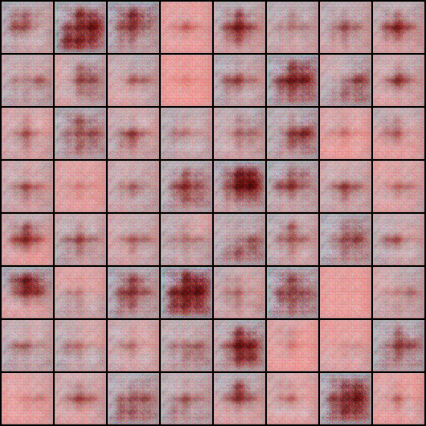
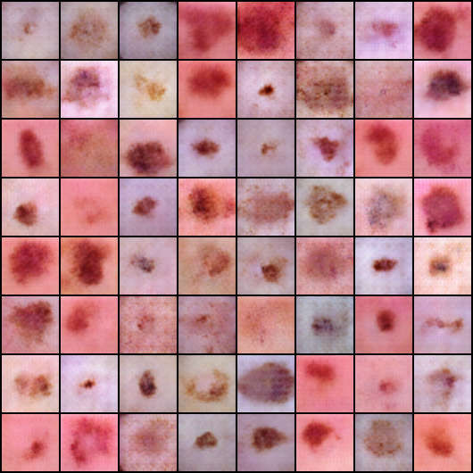
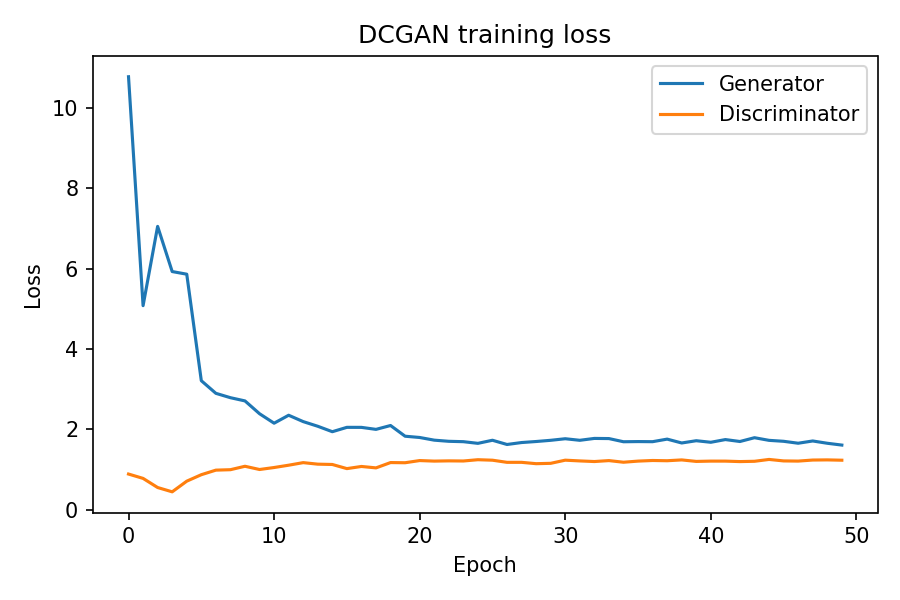

# DCGAN on DermaMNIST (Skin-Lesion Images)

A small learning project: training a Deep Convolutional GAN (DCGAN; Radford et al., 2015) in PyTorch on
**DermaMNIST**, a public dermatoscopic image dataset from [MedMNIST](https://medmnist.com/)
(derived from HAM10000; 7 diagnostic classes, class-imbalanced).

## Motivation
Skin-lesion images are a small-scale, imbalanced medical dataset, which makes them a useful test bed for
studying whether synthetic images can support limited data. This project is a first step: training a basic
GAN and examining its stability and sample quality.

## Dataset
- **DermaMNIST** (MedMNIST v2), downloaded automatically through the `medmnist` package
- Training split: 7,007 images, used at 64×64 resolution, all classes (unconditional)
- Pixel values normalized to [-1, 1]

## Model and Training
- **Generator:** 5 transposed-convolution layers with BatchNorm and ReLU, Tanh output (100-dim noise → 64×64 RGB)
- **Discriminator:** 5 convolution layers with BatchNorm and LeakyReLU, one real/fake logit
- **Loss / optimizer:** binary cross-entropy with logits, Adam (lr 2e-4, β1 0.5), one-sided label smoothing (0.9)
- **Run:** 50 epochs, batch size 128, seed 42, single GPU (Google Colab)

## Setup
```bash
pip install -r requirements.txt
python train_dcgan.py --epochs 50                  # all classes, 64x64
python train_dcgan.py --epochs 100 --class_id 4    # a single lesion class
```
The dataset downloads automatically. A free Google Colab GPU is sufficient.

## Outputs
Generated in `outputs/` when you run the script:
- `samples_epoch_XXX.png`: samples from a fixed noise vector
- `loss_curve.png`: generator and discriminator loss
- `generator.pt`: generator weights

Example results from the 50-epoch run are stored in `assets/`.

## Results

**Generated samples**

| Epoch 5 | Epoch 50 |
|:---:|:---:|
|  |  |

**Training loss**



**Observations**
- **Stability.** After a high generator loss in the first epochs (about 10.9 at epoch 1), training settled from around epoch 20, with discriminator loss near 1.2 and generator loss near 1.7. There was no divergence.
- **Sample quality.** At epoch 5, samples are blurry color blobs. By epoch 50, most show a lesion-like patch on a skin-toned background, with variation in lesion size, color, shape, and position.
- **Diversity.** No obvious mode collapse was seen in the 64-sample grid.
- **Limitations.** Samples are still somewhat soft, and some show checkerboard artifacts, a known effect of transposed convolutions.

## Limitations
- Evaluation is **visual only**. No quantitative metric (e.g., FID) was computed, and GAN losses do not directly measure image quality.
- The model is **unconditional**, so it does not control which lesion class is generated, and it does not address class imbalance yet.
- Images are low resolution (64×64) and from one dataset. Generated images are not clinically validated and should not be used for diagnosis.

## Future Work
- Class-conditional GAN to generate specific lesion classes
- Quantitative evaluation with FID
- Comparison with a DDPM trained on the same data
- Testing whether synthetic images improve a downstream lesion classifier on imbalanced data

## Repository Structure
```
.
├── train_dcgan.py
├── requirements.txt
├── README.md
└── assets/
    ├── samples_epoch_005.png
    ├── samples_epoch_050.png
    └── loss_curve.png
```

## References
- Radford, Metz, Chintala. *Unsupervised Representation Learning with Deep Convolutional Generative Adversarial Networks*, 2015.
- Yang et al. *MedMNIST v2: A large-scale lightweight benchmark for 2D and 3D biomedical image classification*, Scientific Data, 2023.
- Tschandl et al. *The HAM10000 dataset*, Scientific Data, 2018.
